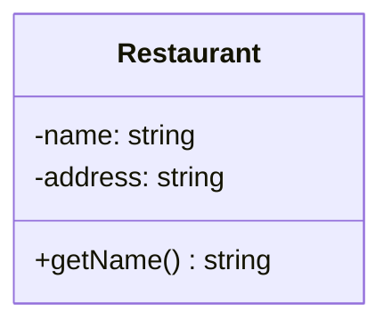
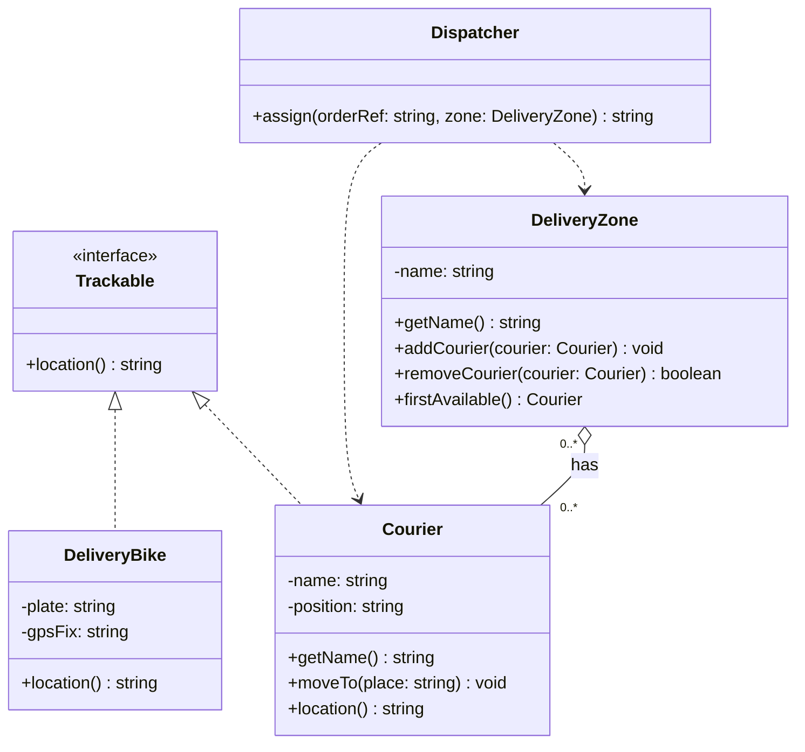
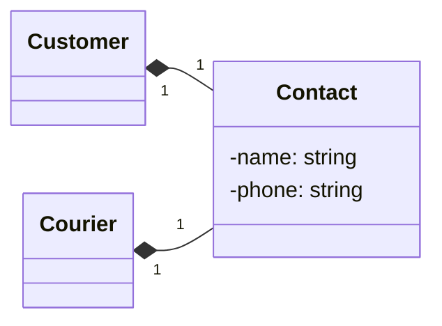
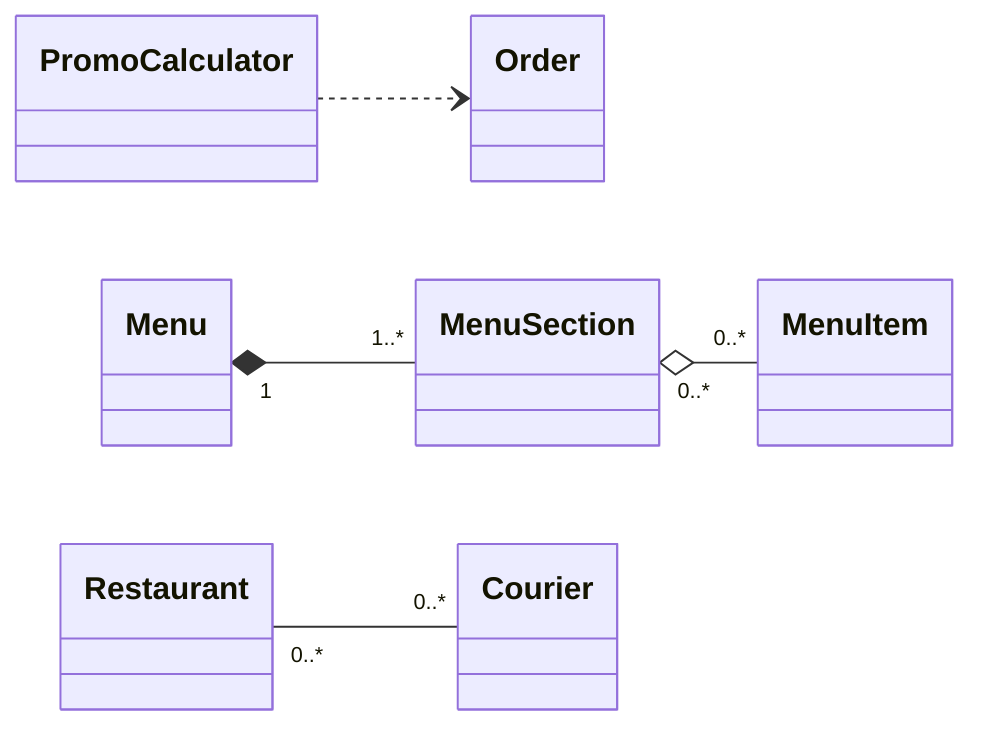
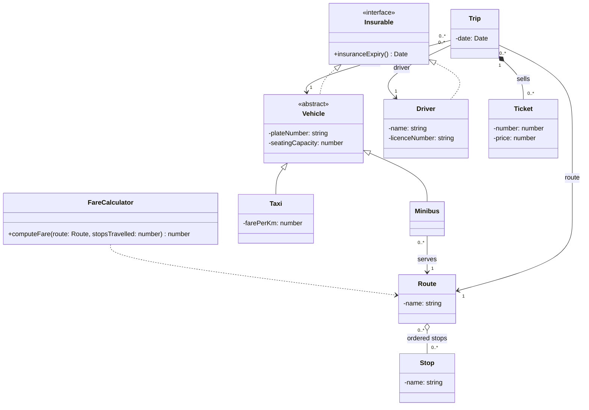
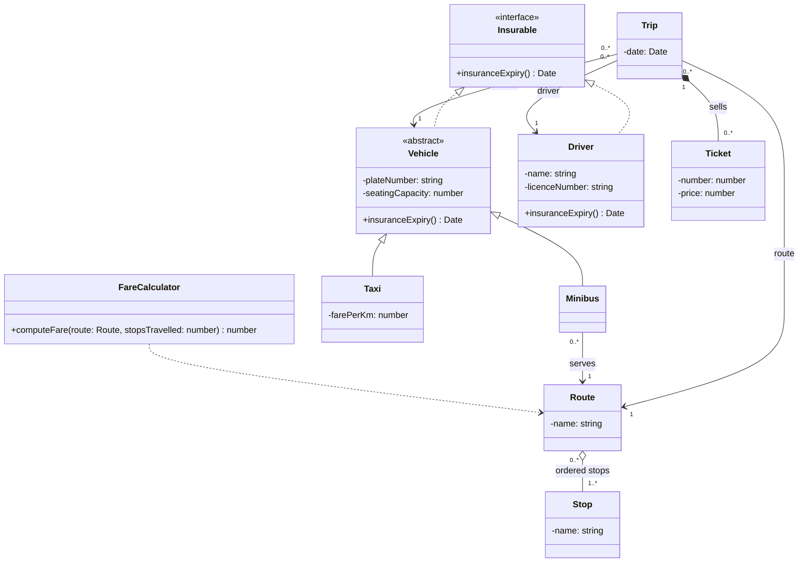

# Lab 5 — UML, Part 1: Class Diagrams — ANSWERS

---

## Step 1



---

## Step 4

**Prediction 1** (written before adding the lines):

| Line | Will it be underlined in red? Which symbol in the diagrams of Steps 1 and 3 tells you? | The error message |
|---|---|---|
| (a) `new MenuItem("Water", 300)` | Yes. `MenuItem` has the `<<abstract>>` stereotype in the Step 3 diagram, so it cannot be instantiated. | Cannot create an instance of an abstract class. |
| (b) `thieb.category()` | Yes. `category()` is written `#category()` in the Step 3 diagram: `#` means protected, so it can only be called from inside `MenuItem` and its subclasses, not from outside. | Property 'category' is protected and only accessible within class 'Dish' and its subclasses. |
| (c) `awa.name` | Yes. `name` is written `-name` in the `Customer` box of Step 1: `-` means private, so only `Customer` itself can read it. | Property 'name' is private and only accessible within class 'Customer'. |

---

## Step 5

**Question 1** (diagram: `Customer "1" -- "0..*" Order` and `OrderLine "0..*" --> "1" MenuItem`)

- (a) **Yes.** `0..*`, at the `Order` end. The minimum is 0, so a customer can have zero orders.
- (b) **No.** `1`, at the `Customer` end. Each order is linked to exactly one customer.
- (c) **Yes.** `0..*`, at the `OrderLine` end. Many order lines can refer to the same menu item (Bissap).
- (d) **No.** `1`, at the `MenuItem` end. Each order line refers to exactly one menu item.

---

## Step 6

**Question 2.** If an order only kept a list of `MenuItem`s, the quantity would have nowhere to live. Awa's "2 Thieboudienne" would have to be the same item listed twice. The quantity cannot be stored in `MenuItem` itself, because that object is shared by every order: changing it to 2 would change it for everybody. `OrderLine` is the class of the link, so it holds the data that belongs to *this item in this order* (the quantity) and gives `subtotal()` a place to be computed.

---

## Step 7

**Question 3.** An `OrderLine` is owned by its `Order` (it is created by the order and means nothing without it), so the link is a composition (filled diamond), whereas a `MenuItem` exists independently on the menu and is only referred to by many lines, so an `OrderLine` does not own it and the link has no diamond.

---

## Step 8

**Question 4.**

- (a) **No, the code is not wrong.** The line between `Customer` and `Order` has no arrow, so it only says the two classes are related; it does not say that a `Customer` object must store its orders. The association is implemented in one direction only: `Order` has a `customer` field. This is the same reason the diagram does not show the `customer` and `lines` fields as attributes: the association line already says it. Nobody needs `customer.orders` in this program, so we do not add it.
- (b) **Neither is strictly wrong, but they disagree.** The diagram states that an order contains at least one line (`1..*`), while `new Order(awa)` creates an order with zero lines, and nothing in the code forces a first line. One change that makes them agree: change the diagram to `Order "1" *-- "0..*" OrderLine` (an order starts empty and receives its lines with `addLine`). The other solution would be to change the code so that the constructor takes a first item and quantity.

---

## Part B diagram



Note: the `couriers` field of `DeliveryZone` is not repeated in the box because the aggregation line already shows it (same convention as `lines` in the Step 8 diagram). `firstAvailable()` returns `Courier | undefined`; the diagram shows `Courier`.

---

## Step 10

**Prediction 2** (written before running): the two new lines are

```text
Moussa
undefined Moussa Médina
```

Reasoning: after `addCourier(moussa)`, the plateau zone's first courier is Moussa. After `removeCourier`, the plateau zone is empty (`undefined`), the Médina zone has Moussa, and `moveTo("Médina")` makes his location `Médina`. I ran it and the output matched.

**Question 5.** The lines `plateau.removeCourier(moussa); medina.addCourier(moussa); moussa.moveTo("Médina");` and the line `console.log(... moussa.location())` show it. A filled diamond (composition) means the zone owns the courier: the courier would belong to one zone only, and would disappear with it. But `moussa` is created **outside** any zone (`new Courier(...)`), is **removed** from the plateau zone and still exists afterwards (`moussa.location()` still works), and is then **added to another zone** (`medina`). A part of a composition cannot be moved between wholes or live without them, so the hollow diamond (aggregation) is the correct one.

**Multiplicities.** Both ends are `0..*`. A zone can hold zero or many couriers (`couriers` is an array that starts empty, with no limit), and nothing in `addCourier` stops us from adding the same courier to two zones (or twice to the same one), so a courier can be in `0..*` zones.

---

## Step 11

**Question 6.** `Dispatcher` would need a **field** that keeps a `DeliveryZone` (for example `private zone: DeliveryZone`) for the whole life of the object. That makes it an association (solid line). Today it only receives a zone as a parameter of `assign()` and forgets it at the end of the call, which is a dependency.

The two dependencies are `Dispatcher ..> DeliveryZone` (parameter `zone`) and `Dispatcher ..> Courier` (local variable `courier`, on which `getName()` is called).

---

## Step 12

**Question 7.**

| Relationship | Line number in `dispatch.ts` | That line of code |
|---|---|---|
| `Courier` realizes `Trackable` | 5 | `class Courier implements Trackable {` |
| `DeliveryBike` realizes `Trackable` | 27 | `class DeliveryBike implements Trackable {` |
| `DeliveryZone` aggregates `Courier` (`0..*` – `0..*`) | 43 | `private couriers: Courier[] = [];` |
| `Dispatcher` depends on `DeliveryZone` | 70 | `assign(orderRef: string, zone: DeliveryZone): string \| undefined {` |
| `Dispatcher` depends on `Courier` | 71 | `const courier = zone.firstAvailable();` |

---

## Step 13

**Prediction 3** (written before running):

```text
6500 5000
26500 25000
```

**Checkpoint 13.** Fatou's total changed because her order and Awa's order contain **the same `OrderLine` object** (`addExistingLine` pushed the very same reference, it did not create a copy). When `order.getLines()[0].changeQuantity(10)` changed the quantity of that one object, both orders saw the change, because both point to it.

---

## Step 14

**Question 8.** The false part is **"each order line belongs to exactly one order, which owns it"**. The line at index 0 now belongs to two orders, and anybody outside can change it without the order knowing, so the order no longer controls its own parts.

- `getLines()` hands the parts **out**: it returns the real internal array, so outside code can take an `OrderLine` and modify it.
- `addExistingLine()` takes a part **in**: it accepts an `OrderLine` created elsewhere (and already owned by another order) instead of creating the line itself, so one line ends up in two orders.

---

## Step 16

**Question 9.** Tests applied to "`Courier` is a subclass of `Customer`":

- **Is-a — fails first.** A courier is not a kind of customer: a courier delivers food, a customer orders it. They only happen to share two fields (a name and a phone number), and sharing fields is not a reason for inheritance.
- Substitution: it would also fail. A `Courier` could be passed anywhere a `Customer` is expected, for example `new Order(courier)`, so a courier could be the customer of an order, which the restaurant never intended.
- Stability: it would also fail. A person can be a customer today and a courier tomorrow (or both at the same time), and an object cannot change its class.

**What I would draw instead:** no triangle. `Customer` and `Courier` stay two independent classes. If we want to avoid duplicating the name and phone, we extract a small class `Contact` (`name`, `phone`) and each of the two classes has a `Contact`, with a composition line (`Customer *-- Contact` and `Courier *-- Contact`).



---

## Question 10 — Part D



| # | Relationship | Reason, in one sentence |
|---|---|---|
| 1 | Dependency (dashed arrow) | `PromoCalculator` only receives an `Order` as a parameter, reads it and keeps nothing. |
| 2 | Composition (filled diamond) | The menu creates its sections and a section means nothing outside its menu, so the menu owns them. |
| 3 | Aggregation (hollow diamond) | A section is made of menu items, but items exist on their own and can be shared (Bissap in two sections). |
| 4 | Association (plain line) | Restaurants and couriers are independent, with no whole–part link, and each side can be linked to many of the other. |

---

## Part E — first draft



---

## Part E — final



**Question 11.**

| Classes | Relationship | Requirement sentence that justifies it |
|---|---|---|
| `Minibus`, `Vehicle` | Generalization | "Each vehicle is either a minibus … or a taxi" |
| `Taxi`, `Vehicle` | Generalization | "Each vehicle is either a minibus … or a taxi" (and "There is no such thing as a plain vehicle", hence `Vehicle` is abstract) |
| `Vehicle`, `Insurable` | Realization | "Vehicles and drivers must both be able to report `insuranceExpiry(): Date`" |
| `Driver`, `Insurable` | Realization | "Vehicles and drivers must both be able to report `insuranceExpiry(): Date`. They are not the same kind of thing." |
| `Trip`, `Driver` | Association (`0..*` – `1`) | "A trip records a date, the driver, the vehicle and the route. A driver makes many trips" |
| `Trip`, `Vehicle` | Association (`0..*` – `1`) | "A trip records … the vehicle … A driver makes many trips, and so does a vehicle." |
| `Trip`, `Route` | Association (`0..*` – `1`) | "A trip records a date, the driver, the vehicle and the route." |
| `Minibus`, `Route` | Association (`0..*` – `1`) | "a minibus (which serves one fixed route)" |
| `Trip`, `Ticket` | Composition (`1` – `0..*`) | "tickets are sold. A ticket … belongs to exactly one trip, and means nothing without it." |
| `Route`, `Stop` | Aggregation (`0..*` – `1..*`) | "A route has a name and an ordered list of stops. The same stop … is used by several routes." |
| `FareCalculator`, `Route` | Dependency | "A fare calculator computes a ticket price from a route and a number of stops travelled. It keeps nothing." |

- (a) **The hardest was `Route` – `Stop`.** "Has a list of stops" sounds like whole–part, so I thought of composition. But the requirement says the same stop is used by several routes, and a part of a composition cannot be shared by several wholes, so I chose aggregation (hollow diamond) with `0..*` routes per stop.
- (b) Two changes from the first draft:
  1. I added `+insuranceExpiry() Date` to the `Vehicle` and `Driver` boxes. In the first draft only the interface had the operation, but a class that realizes an interface must show the operation it provides (`Minibus` and `Taxi` inherit it from `Vehicle`).
  2. I changed the multiplicity of stops per route from `0..*` to `1..*`. The requirement says a route has an ordered list of stops, and a route with no stop at all makes no sense; I kept `0..*` on the other side because a stop can exist before any route uses it.
